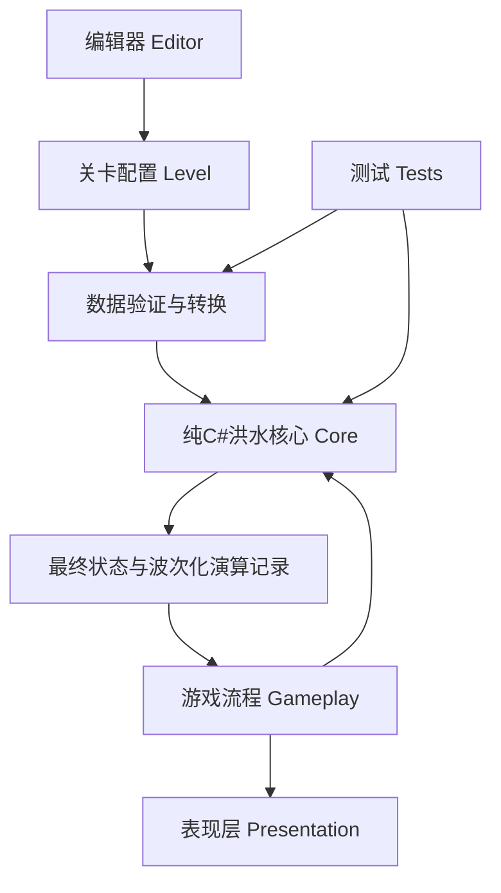
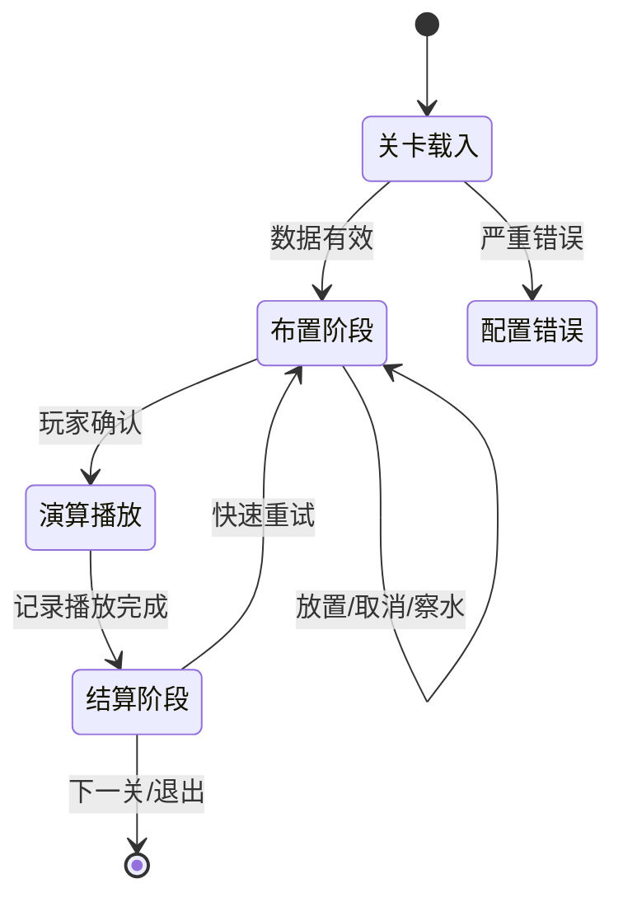

---
tags:
  - 项目
  - 数媒竞赛
  - 技术架构
  - Unity
  - 山河未尽
date: 2026-10-17
status: 已确认架构基线
source_of_truth: "[[山河未尽-完整游戏设计文档]]"
---

# 山河未尽 · 技术架构说明

> [!info] 文档定位
> 本文是 [[山河未尽-完整游戏设计文档]] 的技术展开，用于程序实现、美术接入、关卡制作、测试与团队交接。玩法结论以完整游戏设计文档为准；本文不得自行补完其中标记为“待确定”的规则。

## 一、架构结论

《山河未尽》采用轻量的数据驱动分层架构：**ScriptableObject 保存静态关卡配置，纯 C# 核心负责确定性洪水演算，游戏流程状态机协调玩家命令与结算，Unity 表现层根据波次化演算记录播放地块、河水、UI、声音和镜头。**

核心约束：

1. 关卡配置、运行状态和演算记录必须分离；
2. 察水预览与正式洪水必须调用同一个演算核心；
3. GameObject、Prefab、Shader、Collider 和动画不得决定玩法结果；
4. 所有关卡共用一套规则、一个通用关卡场景和同一套数据格式；
5. 白模与正式美术只替换表现方案，不改变关卡逻辑；
6. 第一版保持轻量，不引入 ECS、第三方依赖注入框架、真实流体或大型通用关卡框架。

## 二、参考模式与采用边界

本架构参考以下 GitHub 项目的公开结构，但不直接安装或复制其完整框架：

- [Unity Game Programming Patterns Demo](https://github.com/Unity-Technologies/game-programming-patterns-demo)：采用 State、Command 与 Observer 的职责划分；
- [Unity Open Project 1](https://github.com/UnityTechnologies/open-project-1/wiki/Game-architecture-overview)：借鉴 ScriptableObject 配置和跨表现系统的事件通道；
- [thefcan/unity-match3](https://github.com/thefcan/unity-match3)：借鉴“纯 C# 规则核心输出步骤记录，Unity 视图只负责播放”的边界；
- [GameplaySystem/PuzzleFramework](https://github.com/gameplaysystem/puzzleframework)：借鉴关卡原稿与运行状态分离、生成式场景和编辑器验证思路。

不采用这些项目中的完整场景框架、联网、依赖注入、通用网格包或与本游戏无关的系统。若未来需要复制具体代码，必须另行核对许可证、Unity 版本和第三方依赖。

## 三、模块与依赖



### 3.1 洪水核心 Core

负责：

- 河道节点和有向连接；
- 水量、容量、超载、改道与回积；
- 堤坝、泄水口和故道对河网的影响；
- 保护目标受损、成功、失败和评分依据；
- 波次化演算记录；
- 可替换的路径选择策略。

禁止引用 `UnityEngine`。核心类型只使用整数、布尔值、枚举、稳定编号和普通集合。

### 3.2 关卡配置 Level

负责使用 ScriptableObject 保存策划原稿，并转换为核心可读取的不可变数据。配置资产不能保存本局水量、棋子实例或目标受损状态。

### 3.3 游戏流程 Gameplay

负责：

- 关卡会话；
- 四阶段状态机；
- 玩家命令验证与方案管理；
- 察水预览缓存和失效；
- 正式触发、播放协调、结算与快速重试。

### 3.4 表现层 Presentation

负责：

- 地图、地块和河道生成；
- 点击输入转发；
- 水头、承压、漫溢、改道和破坏动画；
- 信息图层、UI、声音和镜头；
- 白模与正式表现方案切换。

表现层只能读取演算记录和当前只读快照，不得重新计算水路或胜负。

### 3.5 编辑器 Editor

负责：

- 关卡资产创建与检查；
- 河道连接和方向可视化；
- 白模生成；
- 重复编号、非法连接、环路和出口可达性诊断。

### 3.6 测试 Tests

EditMode 测试覆盖纯 C# 核心和数据转换；PlayMode 测试只验证通用关卡场景、Prefab 绑定和一次完整流程。

## 四、建议目录与程序集

以下名称属于实现工作基线，可在编码前根据现有目录小幅调整：

```text
Assets/Script/
├─ Core/
│  ├─ Model/
│  ├─ Simulation/
│  ├─ Commands/
│  └─ Results/
├─ Level/
│  ├─ Definitions/
│  ├─ Conversion/
│  └─ Validation/
├─ Gameplay/
│  ├─ Session/
│  ├─ States/
│  └─ Retry/
├─ Presentation/
│  ├─ Map/
│  ├─ River/
│  ├─ Interaction/
│  └─ UI/
├─ Editor/
└─ Tests/
   ├─ EditMode/
   └─ PlayMode/
```

建议程序集：

| 程序集 | 依赖 | 用途 |
|---|---|---|
| `Shanhe.Core` | 无 Unity 引用 | 洪水规则、状态、命令结果和演算记录 |
| `Shanhe.Level` | Core、Unity | ScriptableObject、转换与验证 |
| `Shanhe.Gameplay` | Core、Level、Unity | 关卡会话与状态机 |
| `Shanhe.Presentation` | Core、Gameplay、Unity | 地图、河水、交互、UI和动画 |
| `Shanhe.Editor` | Level、Presentation、UnityEditor | 关卡工具与检查器 |
| `Shanhe.Tests.EditMode` | Core、Level、Test Framework | 核心和数据测试 |
| `Shanhe.Tests.PlayMode` | Gameplay、Presentation、Test Framework | 场景接线烟雾测试 |

所有 Inspector 字段、Tooltip、菜单、错误信息与交接注释使用中文。类名和接口名可以保留英文，以保持 C# 可读性与工具兼容性。

## 五、数据模型

### 5.1 关卡配置

每关一个主 `LevelData` 资产，聚合以下配置：

| 数据 | 主要字段 |
|---|---|
| 地块 | 稳定编号、网格坐标、高度等级、逻辑地形类型、视觉键 |
| 河道节点 | 稳定编号、所在地块、节点类型、容量、初始状态 |
| 河道连接 | 稳定编号、起点、终点、默认是否开放、路径策略预留参数 |
| 保护目标 | 稳定编号、地块、目标类型、必保标记、评分作用、受灾关系 |
| 交互点 | 稳定编号、允许棋子、关联连接、能力要求、表现锚点键 |
| 故道 | 稳定编号、组成节点和连接、发现条件、下游目标 |
| 关卡条件 | 初始来水、棋子数量、主线目标、失败条件、星级条件 |

稳定编号不得使用 GameObject 名称或实例 ID。重命名场景对象不能破坏关卡逻辑。

### 5.2 不可变核心定义

关卡载入时先验证 ScriptableObject，再转换为不包含 Unity 类型的不可变定义。核心只读取该定义，不持有 ScriptableObject 引用。

### 5.3 运行状态

运行状态由不可变定义创建，包含：

- 各河段当前水量和承压状态；
- 各连接的开放、阻断和恢复状态；
- 堤坝、泄水口与故道状态；
- 保护目标状态；
- 棋子余量；
- 当前游戏阶段。

重试时丢弃运行状态并从初始快照重建。

### 5.4 演算记录

每条记录至少包含：

- 波次编号与同波并行组；
- 事件类型；
- 起点编号和终点编号；
- 输入水量、接受水量、超载水量；
- 变化前后状态；
- 受影响目标；
- 原因代码。

原因代码至少区分正常通水、容量不足、堤坝阻断、泄水口关闭、故道未恢复、没有可行出口、回积和破坏。

## 六、关卡会话与状态机



察水是布置阶段的只读操作。玩家方案变化后，旧预览必须立即失效。玩家确认时冻结最终方案；演算播放阶段不接受治理命令，但保留相机平移和缩放。

场景中的 `GameSessionController` 是组合与协调入口，不是全局单例，也不亲自实现洪水规则。

## 七、命令与方案

命令只包含玩法数据，不引用场景对象。第一版命令范围：

- 放置／移除堤坝；
- 安装／移除泄水口；
- 切换泄水口开关；
- 挖掘／取消挖掘故道。

命令处理顺序：

1. 检查当前阶段；
2. 检查目标与交互点；
3. 检查能力、棋子余量与冲突；
4. 原子地应用命令；
5. 返回成功或中文拒绝原因；
6. 成功后通知表现层并使察水预览失效。

第一版不保存复杂逆命令。取消操作时从初始状态重新应用当前有效命令列表；地图和棋子规模较小，该方案更容易验证。

## 八、洪水演算

### 8.1 演算输入与输出

输入为不可变关卡定义、当前布置方案和路径策略；输出为最终状态、波次化演算记录及结算依据。

### 8.2 单轮流程

1. 汇总本轮进入各河段的水量；
2. 按稳定编号处理河段；
3. 检查连接状态与剩余容量；
4. 接收容量范围内的水；
5. 收集超载水量；
6. 调用路径策略选择其他下游；
7. 无路可走时结算回积或破坏；
8. 写入记录并生成下一轮输入；
9. 没有待处理水量后结束；
10. 验证水量守恒并生成结算结果。

同轮多路来水必须先汇总，禁止遍历顺序影响结果。第一版使用整数水量，禁止负水量和负容量。

### 8.3 路径策略

路径策略必须是独立接口，接收当前节点、候选连接、运行状态和关卡定义，返回稳定排序或分配结果。

尚待验证的候选包括：显式优先级、地势、剩余容量和组合权重。任何具体策略在确认前不得写成不可替换的核心分支。

### 8.4 河网限制

比赛版先采用有向无环河网。载入时检测环路并阻止开局。若未来确需回流，必须另写设计，不在第一版中预埋复杂循环模拟。

## 九、洪水动画与表现协议

洪水核心瞬间完成计算，表现层根据记录逐波播放：

```text
入口水头
→ 上游推进
→ 分叉并行
→ 承压
→ 改道或漫溢
→ 目标受损
→ 水流离开出口
```

每个河道视图至少支持：

- 设置洪水到达进度；
- 设置承压程度；
- 设置漫溢程度；
- 设置浑浊程度；
- 恢复初始表现。

现有“洪水扩张进度”只负责河槽向两岸扩张。新增“洪水到达进度”控制纵向水头。直线、转弯和分叉河道各自提供灰度推进遮罩；黑色为上游，白色为下游。分叉支路必须能独立播放。

播放控制器先播放同一波的并行记录，等待该波关键动画完成后再进入下一波。动画时长、加速和跳过只影响播放，不改变核心结果。

## 十、场景、Prefab与表现方案

### 10.1 场景

建议保留启动、主菜单、通用关卡和开发测试场景。所有正式关卡复用通用关卡场景，只替换 `LevelData`。

### 10.2 地块Prefab

统一层级：

```text
TileRoot_编号
├─ Base
├─ PrimaryContent
├─ RiverContent
├─ InteractionAnchors
├─ StateEffects
└─ ClickArea
```

高度由统一锚点处理，各美术 Prefab 不自行补偿不同高度。

### 10.3 河道Prefab

至少支持直线、转弯、三向分叉、三向汇流、入口、出口和隐藏故道。形状和旋转优先由连接方向推导；视觉通道与逻辑连接使用稳定编号绑定。

### 10.4 表现方案

同一份关卡数据可以选择白模表现方案或正式表现方案。表现方案将视觉键映射为颜色、材质、Prefab 和效果。切换方案不得改变任何核心输入。

## 十一、系统通信

洪水核心、命令验证与结算使用明确的直接调用，不经过全局事件总线。

表现通知可以使用类型明确的 C# 事件或小范围 ScriptableObject 事件通道，例如：

- 阶段变化；
- 察水结果生成或失效；
- 演算记录开始播放；
- 目标受损；
- 播放完成；
- 结算结果生成。

事件监听者不得修改已经确定的演算结果。跨场景事件通道只在确有跨场景通信需求时增加。

## 十二、存档与快速重试

玩家存档只保存关卡外进度：关卡解锁、最高成绩、能力与剧情解锁、教学记录、设置和版本号。使用 JSON 写入 `Application.persistentDataPath`，第一版不接云存档。

快速重试步骤：停止播放、复位表现、丢弃运行状态、从初始快照重建、按策略清空或展示上次方案残影、返回布置阶段。默认先清空方案；残影和演算加速保持待验证。

## 十三、验证与错误处理

严重配置错误必须阻止开局：

- 稳定编号重复；
- 缺少入口或出口；
- 连接引用不存在节点；
- 容量或水量非法；
- 河网存在循环；
- 交互点引用非法连接；
- 必需出口不可达。

普通风险可以警告但不阻止开局，例如未使用的可选目标或没有美术映射的白模视觉键。

核心测试至少覆盖：

1. 相同输入产生相同结果；
2. 同轮多路来水先汇总；
3. 超载水正确改道；
4. 堤坝关闭连接；
5. 泄水口只能依附堤坝；
6. 故道一次整体恢复；
7. 察水与正式演算一致；
8. 重试恢复初态；
9. 水量守恒；
10. 环路和无效引用被拒绝。

## 十四、现有工程迁移

保留并演进现有成果：

| 现有内容 | 迁移方向 |
|---|---|
| `TileData` | 保留坐标和高度，补稳定编号、逻辑类型和视觉键 |
| `LevelData` | 继续作为每关入口，聚合河网、目标、交互点和条件 |
| `TileDefinition` | 收敛为纯视觉定义或表现方案条目 |
| `MapGenerator` | 继续生成地图，改为读取关卡数据和表现方案 |
| `RiverVisualController` | 增加到达、承压、漫溢和复位接口 |
| `StraightRiver.prefab` | 作为第一种正式河道模块接入逻辑连接 |
| 正交相机控制器 | 保留，演算阶段仍允许移动和缩放 |

迁移顺序遵循“先保护现有成果，再增加新边界”，不一次性重写白模系统。

## 十五、实施阶段

1. 建立 Core、Level、Gameplay、Presentation 与 Tests 的程序集边界；
2. 建立稳定编号、不可变关卡定义、运行状态、验证和转换；
3. 用测试驱动实现最小洪水演算与波次记录；
4. 在同一最小分叉河网中验证路径策略；
5. 接入堤坝命令、关卡会话和快速重试；
6. 接入察水预览并证明与正式结果一致；
7. 扩展泄水口和故道命令；
8. 接入水头推进遮罩和波次播放；
9. 完成通用关卡场景、白模／正式表现方案和编辑器验证；
10. 最后扩展完整关卡、美术、音效与剧情演出。

具体文件、接口、测试和验收步骤见 Unity 工程内的实施计划。

## 十六、状态边界

### 已确认

- 分层边界和单向依赖；
- 三类数据分离；
- 四阶段关卡流程；
- 命令修改方案、记录驱动表现；
- 预览与正式演算共用核心；
- 波次化播放与独立水头推进遮罩；
- 通用关卡场景和白模／正式表现方案；
- 关卡外存档和初始快照重试。

### 工作基线

- 整数水量与容量；
- 有向无环河网；
- 从初始状态重新应用命令列表；
- 一个关卡一个主 `LevelData`；
- 模块和程序集命名。

### 待确定

- 路径权重；
- 天然低地蓄水；
- 棋子精确数量；
- 泄水口下游选择；
- 失败中止时机；
- 方案残影、加速和跳过；
- 星级精确规则；
- 四关或五关比赛版本。
